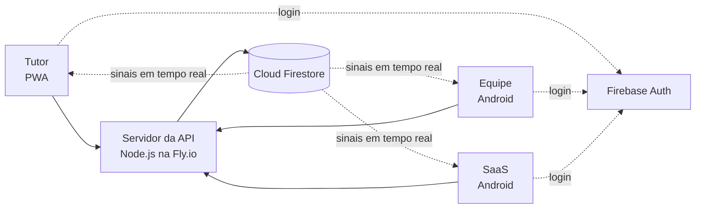

<div align="center">

# 🐾 Cãopanheiro

**Plataforma para petshops: da agenda ao leva e traz do pet, com um app para cada pessoa envolvida.**


-A64B1E)


[Abrir o app do tutor](https://caopanheiro-app.web.app) · [Baixar os apps Android](https://github.com/Falow1/caopanheiro/releases/latest)

</div>

---

## Sobre o projeto

O Cãopanheiro organiza o dia a dia de um petshop e aproxima o petshop de quem é dono do pet. A equipe cuida da agenda, dos atendimentos e do transporte num app próprio. O tutor agenda, pede o leva e traz e acompanha tudo pelo celular. A administração da plataforma gerencia os petshops, os planos e o suporte.

Cada petshop é uma empresa dentro da plataforma, com a própria equipe, catálogo, clientes e plano. A mesma pessoa pode trabalhar em mais de um petshop, ter mais de uma função ou ser cliente de vários petshops com uma única conta.

## Os aplicativos

### 🐶 Tutor — web (PWA)

Para quem é dono do pet. Roda no navegador e pode ser instalado na tela inicial do celular.

- Entra no petshop pelo **código de convite** que o próprio petshop divulga.
- Cadastra os pets escolhendo a raça numa lista, que já diz o porte, e acompanha cuidados, histórico e relatos dos profissionais.
- Agenda serviços pelo catálogo do petshop, com preço e duração oficiais.
- Pede o **transporte** (leva e traz): marca o endereço no mapa e vê a cotação antes de confirmar.
- Acompanha cada etapa da coleta e da entrega e vê no mapa onde está o entregador.
- Vê na revisão do agendamento as formas de pagamento, só como demonstração, sem cobrança.
- Recebe avisos de agenda e transporte e alterna entre os petshops que usa.

### 🏪 Equipe — Android

Um app para todo o time, com uma área para cada função.

| Função | O que faz |
| --- | --- |
| **Gestor** | Agenda, clientes e pets, pets atendidos (raças, portes e filhotes), serviços e preços, horários de funcionamento, equipe e permissões, transportes, link de convite dos tutores, plano e assinatura, suporte e exportação dos dados em CSV |
| **Atendente** | Agenda do dia, recepção dos pets, decisão dos pedidos de transporte e marcação dos pets que o petshop deixa de atender |
| **Profissional** | Atendimentos do dia: inicia, conclui e registra relatos para o tutor |
| **Entregador** | Coletas e entregas etapa por etapa, com registro de ocorrências e a localização enviada durante o transporte |

Os avisos chegam também como notificação no celular, e tocar nela abre os avisos do petshop. Sem internet, o app mostra a última cópia dos dados para consulta. Nenhuma alteração é gravada fora do servidor.

### 🛠️ SaaS — Android

Para a administração da plataforma.

- Painel com métricas da plataforma.
- Petshops, usuários e convites de novos gestores.
- Planos, assinaturas e pedidos de cobrança: troca de plano, renovação, petshop extra e devolução.
- Atendimento dos pedidos de suporte dos gestores, com notificação no celular a cada pedido de suporte ou de assinatura.
- Raças sugeridas por quem não achou a raça do pet na lista.
- Auditoria dos eventos sensíveis de cada petshop.
- Entrada protegida por senha e por um código de confirmação enviado por e-mail.

## Planos

| Plano | O que inclui | Equipe | Valor de referência |
| --- | --- | --- | --- |
| **Grátis** | Agenda, clientes, pets, serviços e equipe de 1 petshop | até 5 pessoas | R$ 0 |
| **Essencial** | Tudo do Grátis, mais o app do tutor com agendamento e avisos | até 10 pessoas | R$ 69/mês |
| **Completo** | Tudo do Essencial, mais transporte com entregador e acompanhamento do tutor | até 25 pessoas | R$ 129/mês |

O primeiro petshop de cada gestor começa com 30 dias de teste no plano Completo. Cada petshop extra custa R$ 39/mês. Quando o plano vence, o petshop passa por um período de tolerância antes de pausar e volta assim que a renovação é confirmada. Os valores podem ser ajustados pela administração.

## Arquitetura



- **Toda gravação passa pelo servidor.** Os apps não escrevem no banco: o servidor confere quem chama, a função da pessoa no petshop, o plano e os conflitos de agenda dentro de transações do Firestore.
- **Tempo real sem expor dados.** Os apps escutam apenas sinais de mudança (um contador por área) e, quando algo muda, refazem as consultas autorizadas.
- **Agenda sem sobreposição.** Um profissional ou um pet nunca ficam em dois atendimentos ao mesmo tempo. Os horários são guardados em UTC e mostrados no fuso do petshop.
- **Repetição segura.** Cada comando gera um recibo: repetir a mesma operação, por exemplo depois de uma queda de conexão, não duplica o efeito.
- **Servidor econômico.** A API desliga sozinha quando fica sem uso e volta na primeira chamada. Uma rotina diária limpa registros temporários e aplica os cancelamentos de fim de ciclo.

## Segurança e privacidade

- As regras do Firestore bloqueiam gravações diretas dos aplicativos.
- O acesso de cada pessoa é conferido no servidor pela função e pelo vínculo com o petshop.
- Login, consulta de convite e envio de e-mail têm limite de tentativas.
- O tutor só vê os próprios pets, agendamentos e transportes.
- Durante o transporte, o servidor guarda só a última posição do entregador, sem o trajeto, e a apaga na entrega.
- O motivo de deixar de atender um pet fica só com a equipe; o tutor vê um aviso neutro com o telefone do petshop.
- Chaves, contas de serviço e senhas nunca ficam no repositório.

## Tecnologias

| Camada | Tecnologia |
| --- | --- |
| Apps | Flutter 3.47 e Dart 3.12, num workspace com pacotes compartilhados |
| Login | Firebase Authentication (e-mail e senha, Google no app do tutor) |
| Banco | Cloud Firestore, com regras e índices versionados |
| API | Node.js 24 com firebase-functions e firebase-admin, servida na Fly.io |
| Web | Firebase Hosting para o PWA do tutor |
| Mapas | OpenStreetMap: Nominatim para endereços, OSRM para rotas e Leaflet no mapa |
| Cache no Android | SQLite para a consulta sem internet do app Equipe |

## Estrutura do repositório

```text
apps/
  tutor_app/                  app do tutor (web/PWA)
  equipe_app/                 app da equipe (Android), com os módulos de profissional e entregador
  saas_app/                   app de administração (Android)
packages/
  caopanheiro_contracts/      contratos de dados entre apps e servidor
  caopanheiro_core/           sessão, ambiente, rede e serviços comuns
  caopanheiro_design_system/  componentes e identidade visual
backend/
  src/                        regras de negócio de cada chamada
  server/                     servidor HTTP da API, sinais em tempo real e rotina diária
  firestore.rules             regras de acesso do banco
```

## Status

Versão 1.3.0, em que o app da equipe e o SaaS recebem notificações no celular, os três aplicativos pedem um código enviado por e-mail na entrada (no app do tutor e no da equipe, só como demonstração, que pode ser pulada), o app do tutor abre com a marca, mostra o histórico de cada pet e as formas de pagamento na revisão do agendamento, a equipe edita o próprio nome e telefone e cada rede de petshops tem um só gestor principal, sobre a 1.2.0, em que o tutor e a equipe escolhem a raça do pet numa lista que já diz o porte, cada pet ganha o ícone da sua raça, o gestor define quais pets o petshop atende e a equipe pode deixar de atender um pet, sobre a 1.1.0, em que o tutor e a equipe veem no mapa onde está o entregador durante o transporte, sobre a 1.0.6, em que o link de convite do app da equipe abre o cadastro também com o app já aberto, a entrada com Google sem internet avisa a falta de conexão e os três aplicativos mostram em português também os seletores de data e os menus do sistema, sobre a 1.0.5, em que o telefone tem a mesma máscara e o mesmo filtro nos três aplicativos e no servidor, o app do tutor fala em petshop no vínculo e explica onde achar o convite, a consulta offline do SaaS vale por 24 horas depois da última conexão e a cópia offline do Equipe e do SaaS não sai do celular por backup nem transferência, sobre a 1.0.0, a primeira publicada. A demonstração pública usa um ambiente de teste com dados fictícios.

Ainda não fazem parte desta versão:

- envio real dos e-mails da plataforma (convite do gestor principal e códigos de verificação); a recuperação de senha e o convite da equipe já saem pelo Firebase;
- pagamento integrado: as cobranças são confirmadas pela administração;
- notificações no app do tutor: os avisos aparecem ao abrir ou atualizar o app;
- apps para iOS.
